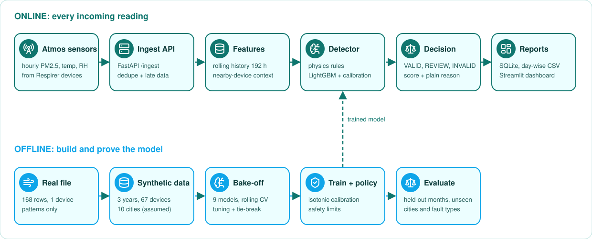
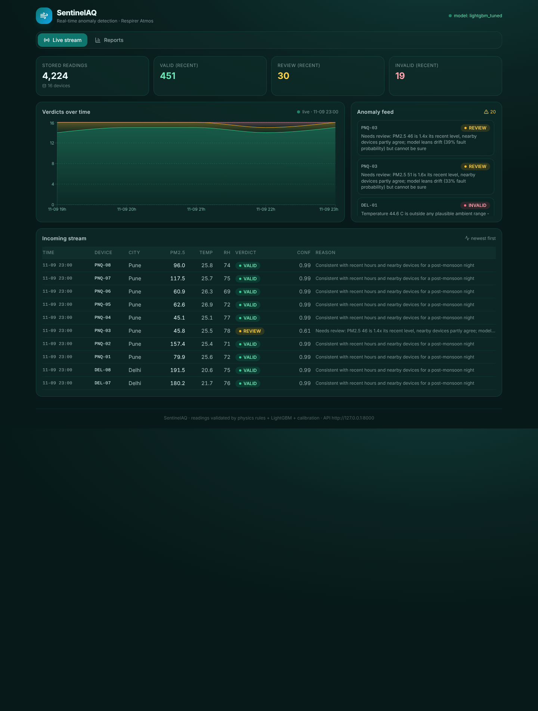

<p align="center">
  
</p>

<p align="center">
  
  
  
  
  
  
  
  
</p>

<p align="center">
  <b>Every reading gets a verdict: VALID, REVIEW or INVALID, with a confidence and a plain-language reason.</b>
</p>

---

## 1. Problem

Respirer's Atmos devices send hourly PM2.5, temperature and humidity. Some readings are wrong: sensor stuck at a sentinel value (3333), saturation, impossible temperature, probe faults, spikes, drift, missing hours. Wrong readings must not reach reports, but real pollution events (Diwali, stubble burning, dust storms) must not be thrown away.

SentinelAQ checks each reading as it arrives and answers: **is this a sensor fault or a real event?**

## 2. How it works

<p align="center">
  
</p>

1. **Rules** catch certain facts: missing data, temp above 55 or below -10, RH outside 0 to 100, PM = 3333, PM above the saturation floor (~2900).
2. **LightGBM** looks at the last 192 hours of the device and the nearby devices in the same city (40 features) and gives a fault probability for 9 classes.
3. **Isotonic calibration** makes the probability honest (70% means about 70%).
4. **3-way policy**: `p_fault < 0.29` VALID, `p_fault > 0.83` INVALID, otherwise REVIEW. Rules always win over the model.
5. **Reason engine** writes the verdict in plain words. Everything is stored in SQLite and shown on the live dashboard.

<p align="center">
  
</p>
<p align="center"><sub>Live stream view — incoming readings scored in real time, with KPIs, verdicts over time and an anomaly feed. The Reports tab adds daily / weekly / monthly / yearly summaries with CSV and PDF export.</sub></p>

## 3. Run it (Windows PowerShell)

### 3.1 One command (recommended)

`run.ps1` sets up the backend venv, installs everything, generates data and trains the model on the first run, runs the tests, then starts the **API + a demo live feed + the dashboard** together.

```powershell
git clone https://github.com/kartikpagariya25/SentinalAQ-Real-Time-Anomaly-Detection-in-Sensor-Data-Streams.git SentinalAQ
cd SentinalAQ
Set-ExecutionPolicy -Scope Process RemoteSigned
.\run.ps1
```

- Dashboard: `http://127.0.0.1:5173`
- API + Swagger: `http://127.0.0.1:8000/docs`

Flags: `-NoFeed` (no demo feed), `-Port 9000`, `-Dev` (Vite dev server while editing the dashboard), `-Fresh` (stop stray processes and clear the live store), `-ReplayDays 30` (how much dataset history the feed streams). `.\backend.ps1 -SetupOnly` installs and trains without starting anything.

Put `device_with_anomaly.xlsx` in `backend\data\raw\` before the first run. Data files are gitignored, so they are never in the repo.

### 3.2 Manual setup (if you want the steps)

```powershell
cd backend
python -m venv .venv
Set-ExecutionPolicy -Scope Process RemoteSigned
.venv\Scripts\Activate.ps1
pip install -r requirements.txt

python -m app.cli profile          # learn patterns from the real file
python -m app.cli generate         # synthetic network: 3 years, 67 devices, 10 cities (~1.76 M rows)
python -m app.cli train            # train winner, calibrate, set policy (~1 min)
python -m app.cli evaluate         # full test report -> reports\evaluation
python -m pytest -q                # 8 tests
```

`compare` (the 9-model bake-off, ~45 min) is optional — the winner is already in `models\selection.json`, so `train` works without it. Use `compare --resume` to reuse saved stage 1-2 results.

### 3.3 Explore the data (CLI)

```powershell
python -m app.cli peek --city Delhi --faults-only --rows 30
python -m app.cli peek --device DEL-01 --start 2025-11-01 --end 2025-11-04 --rows 72
python -m app.cli stream --days 2 --cities Delhi,Pune --delay 0.3 --only-flagged
python -m app.cli peek --city Pune --start 2026-09-01 --end 2026-09-30 --export ..\pune_sep.csv
```

The full dataset is `backend\data\synthetic\sensor_data.parquet`. To read it in a table with proper dates, export a slice with `--export` and open the CSV in Excel or VS Code (Rainbow CSV); a parquet viewer extension also works, but it shows timestamps as epoch milliseconds.

Model metrics and a short guide to every model:

```powershell
.\models.ps1          # table with full names, coverage, precision, speed
.\models.ps1 -Info    # adds a plain-language description of each model
```

### 3.4 Live dashboard

React (Vite + Tailwind + Recharts), talks to the API.

```powershell
cd backend ; python -m app.cli serve --port 8000     # terminal 1: API
cd backend ; python -m app.cli live-feed --loop    # terminal 2: push demo readings over HTTP
cd frontend ; npm install ; npm run dev              # terminal 3: dashboard
```

- **Live stream** tab — KPIs, a stacked hourly bar chart (valid / review / invalid with exact counts), an anomaly feed and a streaming console of readings scored on arrival, refreshing every 2 s.
- **Reports** tab — pick daily / weekly / monthly / yearly + a date, see the summary, charts and anomalies by device, download **CSV** or **PDF**.
- **Dataset**, **Team**, **Respirer** and **About** tabs describe the data, the people and the project.

The demo feed never stamps a reading in the future: it streams past hours from the dataset's own timestamps and adds today's hours as each hour completes.

The API URL is configurable: copy `frontend\.env.example` to `frontend\.env` and set `VITE_API_URL`.

### 3.5 Connect your pipeline (ingestion)

Respirer's pipeline pushes readings to `POST /ingest` and gets a verdict back for each. That is the whole integration — one HTTP call per batch. Example: `backend\examples\push_client.py`.

```powershell
$body = '[{"timestamp":"2026-09-16T09:00:00","device_id":"DEL-01","city":"Delhi","pm25":3333,"temp":31.2,"rh":48}]'
Invoke-RestMethod -Method Post -Uri http://127.0.0.1:8000/ingest -ContentType "application/json" -Body $body
```

```bash
curl -X POST http://127.0.0.1:8000/ingest -H "Content-Type: application/json" \
  -d '[{"timestamp":"2026-09-16T09:00:00","device_id":"DEL-01","city":"Delhi","pm25":3333,"temp":31.2,"rh":48}]'
```

| Method | Path | What it does |
|---|---|---|
| POST | `/ingest` | send a list of readings, get verdicts back |
| POST | `/close-hour/{ts}` | mark devices that sent nothing this hour as dropout |
| GET | `/readings?date=&device=&verdict=&limit=` | stored readings for a day |
| GET | `/readings/recent?limit=&verdict=` | newest readings (drives the live view) |
| GET | `/stats` | live KPIs + recent anomalies |
| GET | `/report/{date}?format=json\|csv\|pdf` | one-day report |
| GET | `/report/range?period=daily\|weekly\|monthly\|yearly&date=&format=json\|csv\|pdf` | period report |
| GET | `/health` | status |

**Optional API key:** set `SENTINEL_API_KEY` before `serve`; clients then send it as the `X-API-Key` header on `/ingest`.

### 3.6 Scheduled email reports

Set SMTP env vars, then send on demand or on a schedule:

```powershell
$env:SMTP_HOST="smtp.gmail.com"; $env:SMTP_USER="you@gmail.com"; $env:SMTP_PASS="app-password"; $env:REPORT_TO="team@respirer.in"
python -m app.cli email-report --period daily                 # send once now
python -m app.cli serve --email-period daily --email-hour 6   # serve + email a daily report at 06:00
```

Each email carries the summary in the body and the full PDF attached.

### 3.7 Troubleshooting

| Problem | Fix |
|---|---|
| `.\run.ps1` says the script is not digitally signed | `Unblock-File .\*.ps1 ; Set-ExecutionPolicy -Scope Process Bypass` |
| Dashboard shows old dates or the old chart | `.\run.ps1 -Fresh`, then hard refresh the browser (Ctrl+F5) |
| `Port 5173 is already in use` | The dashboard is already running; open `http://127.0.0.1:5173`, or close its window and rerun |
| "API not reachable" banner | Start the API with `.\backend.ps1` or `.\run.ps1`; the banner clears by itself |
| Feed warns about future-dated readings | The store is from an older run; use `.\run.ps1 -Fresh` |

### 3.8 Push to GitHub

`push.ps1` (local helper, gitignored) checks branch and remote, scans for stray files, runs tests, asks y/n, then commits and pushes.

```powershell
cd SentinalAQ ; .\push.ps1
```

## 4. Dataset

### 4.1 The real file

| Item | Value |
|---|---|
| File | `device_with_anomaly.xlsx` from Respirer |
| Size | 168 hourly rows, 1 device (one week) |
| PM2.5 | median 24.5, p99 62.9, hour-to-hour correlation (AR1) 0.81 |
| Temp vs RH | RH falls about 3.95 points per degree rise |
| Sentinel | 3333 (stuck) |
| Saturation | 3222 to 3444 |
| Spike | about 74x the neighbouring hours |
| Probe fault | temp 2.1 to 4.8 with RH 100 |
| Location | none in the file |

It is too small to train on. We use it only to learn patterns and as a final reality check.

### 4.2 The synthetic network

| Item | Value |
|---|---|
| Period | 2023-10-01 to 2026-09-30, hourly |
| Size | 67 devices, 10 cities, 1,762,368 rows |
| Climate | per-city presets, rain, fog, heat, winter inversion, dust storms |
| Real events | Diwali, Dussehra, Holi, New Year's Eve, stubble burning (city-wide or single-device pulse) |
| Faults | dropout, stuck, drift, rh_fault, th_fault, spike, saturation, impossible_temp, each with canonical and subtle versions |
| Held-out fault families | double_spike, zero_stuck, noise_burst, temp_step, rh_flat_high (never in training, only in the stress test) |

| Class | Share | Class | Share |
|---|---|---|---|
| normal | 94.33% | th_fault | 0.48% |
| dropout | 2.36% | pollution_event | 0.44% |
| stuck | 0.69% | saturation | 0.28% |
| drift | 0.53% | impossible_temp | 0.20% |
| rh_fault | 0.50% | spike | 0.19% |

**Splits (by time, no shuffling):** train before 2025-07-01, validation to 2026-01-01, test from 2026-01-01. Nagpur and Kolkata are held out completely for the unseen-city test.

**Assumed, not real:** the 10 cities, 67 devices, climate, festival strengths and fault rates. The real file has no location, so "city" is a modelling group.

## 5. Metrics we use, and why

| Metric | Meaning | Why we use it |
|---|---|---|
| Coverage | share of readings decided automatically (not REVIEW) | a system that sends everything to REVIEW is useless |
| Auto-INVALID precision | when we say INVALID, how often it is a real fault | wrongly deleting good data is the costly mistake |
| Fault miss rate | faults that slipped through as VALID | data quality; drift is reported separately |
| Event auto-reject | real pollution events rejected | the cardinal sin of this project |
| Slip next months | miss rate on the months after validation | checks the model does not decay quickly |
| PR-AUC | how well faults rank above good readings | faults are 5% of data, so ROC-AUC would look falsely great |
| F1 (with 95% CI) | balance of precision and recall | one number for comparison with baselines |
| ECE, Brier | are probabilities honest | the policy thresholds depend on this |
| Cross-validation J (rolling origin) | stability across time | avoids picking a lucky split |

## 6. Models trained

All 9 candidates see the same data, same features, same normal-class downsampling (4:1), same calibration, same policy rule. Validation months, reference run:

| Model | Coverage | Auto-INVALID precision | Faults missed | Slip next months | Events rejected | F1 | PR-AUC | CV J (sd) | Fit s | ms/row |
|---|---|---|---|---|---|---|---|---|---|---|
| Logistic regression | 0.0% | 1.000 | 0.0% | 0.1% | 0.0% | 0.667 | 0.569 | | 48 | 0.001 |
| Random forest | 99.1% | 0.990 | 2.1% | 1.0% | 0.0% | 0.877 | 0.916 | 0.823 (0.034) | 93 | 0.013 |
| Extra trees | 99.5% | 0.992 | 2.7% | 0.6% | 1.2% | 0.863 | 0.882 | 0.804 (0.027) | 21 | 0.021 |
| HistGradientBoosting | 99.3% | 0.991 | 1.9% | 1.2% | 0.1% | 0.875 | 0.912 | | 65 | 0.050 |
| XGBoost | 99.2% | 0.992 | 1.7% | 1.6% | 0.0% | 0.875 | 0.911 | | 45 | 0.024 |
| MLP | 97.0% | 0.992 | 1.5% | 1.5% | 0.1% | 0.860 | 0.916 | | 50 | 0.003 |
| LightGBM | 99.2% | 0.994 | 1.9% | 1.2% | 0.1% | 0.876 | 0.918 | 0.826 (0.026) | 42 | 0.184 |
| Soft vote (top 3) | 99.4% | 0.990 | 2.1% | 1.3% | 0.5% | 0.879 | 0.915 | | 156 | 0.218 |
| Extra trees (tuned) | 99.5% | 0.992 | 2.7% | 0.6% | 1.2% | 0.863 | 0.882 | 0.804 (0.027) | 20 | 0.018 |
| **LightGBM (tuned)** | **99.3%** | **0.993** | **2.0%** | **1.3%** | **0.1%** | **0.877** | **0.923** | **0.826 (0.026)** | 32 | 0.154 |

Tuned LightGBM: `num_leaves 127, learning_rate 0.1, n_estimators 200, min_child_samples 20, colsample_bytree 0.6`.

Package versions differ between machines, so your numbers can move in the last digit.

## 7. Selected model and why

**Selected: LightGBM (tuned).**

**Selection rule:** pick the model that decides the most readings automatically (coverage), as long as these safety limits hold on validation:

- auto-INVALID precision at least 0.99
- at most 5% of faults (drift excluded) slip through as VALID, and at most 10% of any single fault type
- at most 3% of real events auto-rejected

Models within 0.3 points of coverage are separated by PR-AUC, then by speed.

**Why LightGBM won:**

- It has the best PR-AUC (0.923), meaning it ranks faults above good readings better than any other model.
- Coverage is 99.3%, effectively tied with the top group, and all safety limits hold.
- It is the most stable across time: best rolling CV score (0.826).
- Event rejection is only 0.1%.
- Fast enough: 0.15 ms per row.

**Why not the others:**

- Logistic regression: faults depend on interactions (RH jump while temp is flat, neighbour agreement). A linear model cannot represent them, so it never decides anything safely.
- MLP: good ranking but sends 3% more readings to REVIEW, and needs scaling and more care in production.
- Extra trees: highest coverage by a hair, but worst PR-AUC (0.882) and 1.2% of events rejected.
- Random forest, HistGB, XGBoost: statistically tied with LightGBM (CV sd is about 0.03). They would also work. LightGBM wins on the tie-break, not by a large margin.
- Soft vote: 5x slower, no gain, more events rejected.

**Honest note on the rule:** the first rule was `F1 - 0.5 x event_reject`. It picked an MLP that decided only 83% of readings. We changed the rule after seeing this, and re-applied it to all models. The new rule matches what operations needs: few REVIEWs, no lost events.

## 8. Final test results

Test period 2026-01-01 to 2026-09-30, never used for training or tuning. Numbers from the full run on the project machine.

| Metric | Result |
|---|---|
| Coverage | 99.29% (REVIEW 0.7%) |
| Auto-INVALID precision | 0.991 |
| Faults auto-INVALID / INVALID or REVIEW | 74.0% / 85.5% |
| Faults missed (drift excluded) | 1.0% |
| F1 (INVALID or REVIEW), 95% CI | 0.861 [0.849, 0.877] |
| ECE / Brier | 0.0004 / 0.0056 |
| Real events auto-rejected / REVIEW / accepted | 0.7% / 12.1% / 87.2% |
| City-wide events rejected / accepted | 0.0% / 99.7% |
| Unseen cities (Nagpur, Kolkata) auto-INVALID precision | 0.955 |
| Real Atmos file | 12 of 12 invalid rows caught, 1 sent to REVIEW (the 566 ug/m3 reading), 0 missed |

**Against simple baselines (same test set):**

| Method | F1 |
|---|---|
| Physics rules only | 0.302 |
| Isolation Forest | 0.597 |
| Rolling z-score | 0.702 |
| **SentinelAQ** | **0.861** |

**Per fault type (reference run):**

| Fault | Auto-INVALID | REVIEW | Missed |
|---|---|---|---|
| th_fault | 99.9% | 0.0% | 0.0% |
| impossible_temp | 99.1% | 0.9% | 0.0% |
| saturation | 95.1% | 4.5% | 0.3% |
| stuck | 93.0% | 7.0% | 0.0% |
| rh_fault | 90.8% | 7.0% | 2.3% |
| spike | 25.3% | 69.3% | 5.4% |
| drift | 3.1% | 21.2% | 75.6% |

**Stress tests:**

| Test | F1 | Recall |
|---|---|---|
| Subtle-only faults | 0.80 | 78.9% |
| Fault families never seen in training | 0.70 | 64.6% |

**Learning curve (PR-AUC):** 3 months 0.84, 12 months 0.92, 18 months 0.925. More data of the same kind helps little.

## 9. Why we made each choice

| Question | Answer |
|---|---|
| Why rules and ML together? | Physics facts (temp 80 C, PM 3333) need no learning and are 100% explainable. ML handles context-dependent faults that rules cannot write down. |
| Why neighbour-device features? | If nearby devices rise together it is a real event, if one jumps alone it is a fault. This is why city-wide events are almost never rejected. |
| Why mask neighbours in 15% of training rows? | The real file is a single device with no neighbours. Masking teaches the model to work without them (RH=7.2 case was missed before). |
| Why calibration? | So the confidence means what it says, and so two thresholds can be set on a real probability. |
| Why a REVIEW state? | A single-device burst and a spike look the same in hourly data. A forced call there is a coin flip, so a human decides. |
| Why causal features only? | The live system only has the past. Batch and stream use the same code (tested), so there is no train/serve gap. |
| Why synthetic data? | 168 rows from one device cannot train anything. The generator copies the real patterns and lets us test events, faults and cities we know the truth for. |
| Why 3 years of data? | Seasons repeat. Fewer than 2 years would hide winter and festival behaviour. |
| Why is drift a fault only at 1.5x or more? | Typical PM sensor tolerance is 25 to 30%. Smaller gains are within normal device-to-device difference. |
| Why downsample normal rows 4:1? | Faults are about 5% of data. Balancing helps the model learn fault shapes, calibration then fixes the probabilities. |
| Why time-based splits? | Shuffled splits leak the future and look better than reality. |
| Why hold out cities and fault families? | To measure what happens when the real world differs from training. |
| Why SQLite? | Zero setup, one file, enough for hourly data from tens of devices. Swap for Postgres when scale needs it. |
| Why FastAPI? | Typed requests, automatic Swagger docs, easy for Respirer's pipeline to call. |
| Why Streamlit? | Fast to build and good enough for an operations view. |
| Why not deep learning (LSTM, autoencoder)? | The data is hourly with few strong faults, tabular features work better, and trees are fast and explainable. The MLP result supports this. |

## 10. Limits

- **Drift:** about 75% not flagged. Early drift looks like normal device differences. Needs a weekly device-level check against a reference monitor.
- **Single-device bursts vs spikes:** cannot be separated from hourly data, they land in REVIEW.
- **Unseen fault families:** about 35% missed. The model only knows what it was trained on. Real labelled faults are the fix.
- **Reason engine:** matches the simulator 86%, but both share the same assumptions. It is a consistency check, not proof.
- **Assumed locations:** the real file has no location.
- **Thresholds drift with seasons.** Recalibrate on recent months regularly.
- **Without neighbours** (single device) the model is weaker: F1 0.81 vs 0.86.

## 11. Needed from Respirer

Device-to-location mapping, multi-device real data, labelled faults, and confirmation whether the 566 ug/m3 reading on 2026-09-16 09:00 was a real event.

## 12. Layout

```
run.ps1        one-command end-to-end setup + launch (API + feed + dashboard)
backend/app/   profile, priors, generator, features, rules, model, compare, evaluate,
               detector, reasons, ingest (SQLite), api (FastAPI), report_pdf,
               mailer (email reports), live (HTTP feed), stream, explore, cli
backend/examples  push_client.py  (how an upstream pipeline connects)
backend/models selection.json (winner), trained models (gitignored)
backend/tests  8 tests
frontend/      React + Vite + Tailwind dashboard (src/), dashboard.py (Streamlit, legacy)
docs/          DECISIONS.md, assets/ (banner, flow)
```

More detail: [docs/DECISIONS.md](docs/DECISIONS.md)

<sub>Banner colours are inspired by an environmental teal and sky theme. No Respirer logo or brand asset is used.</sub>
